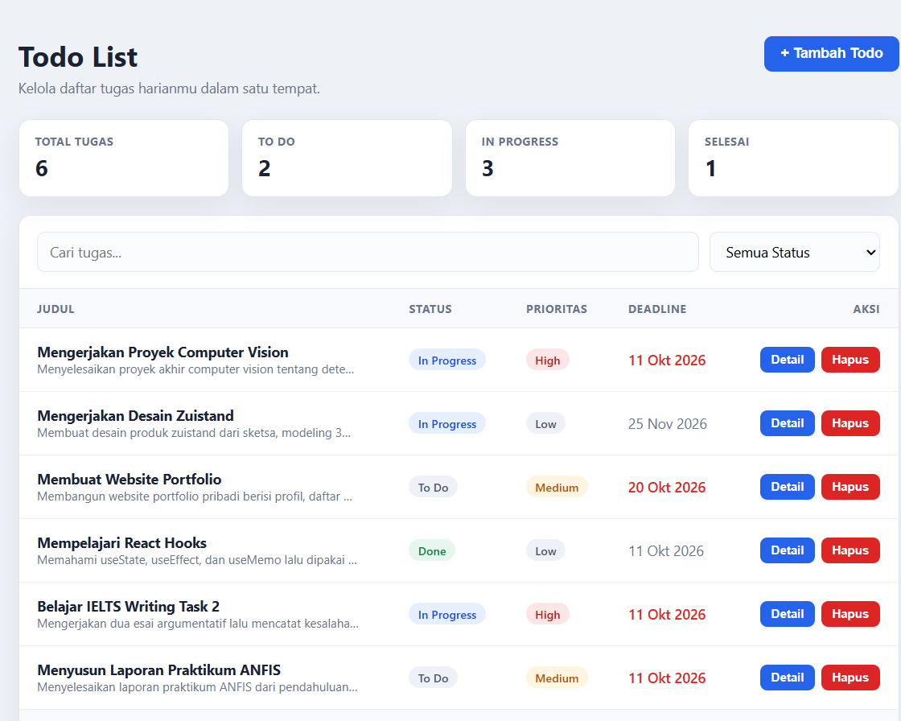
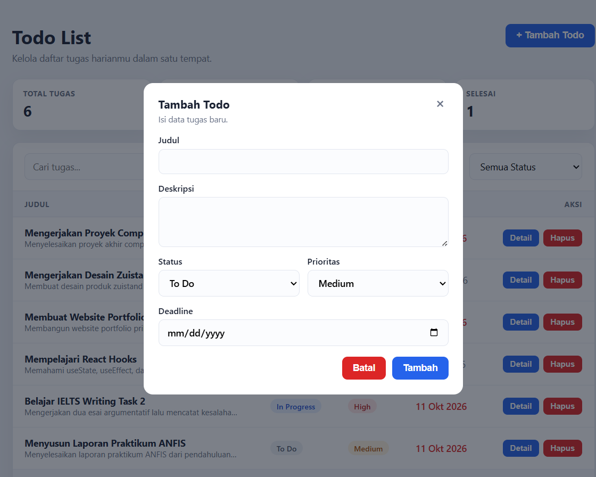
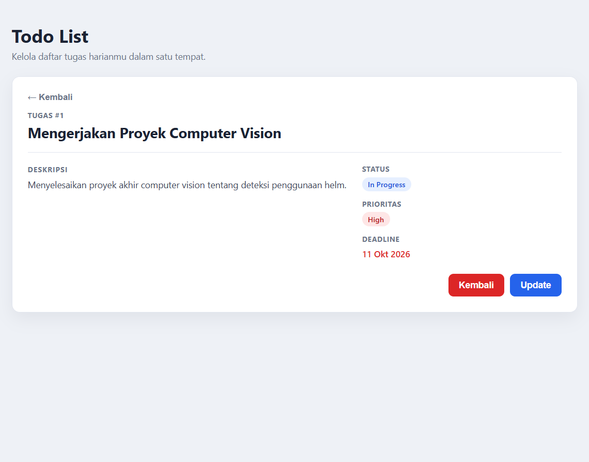
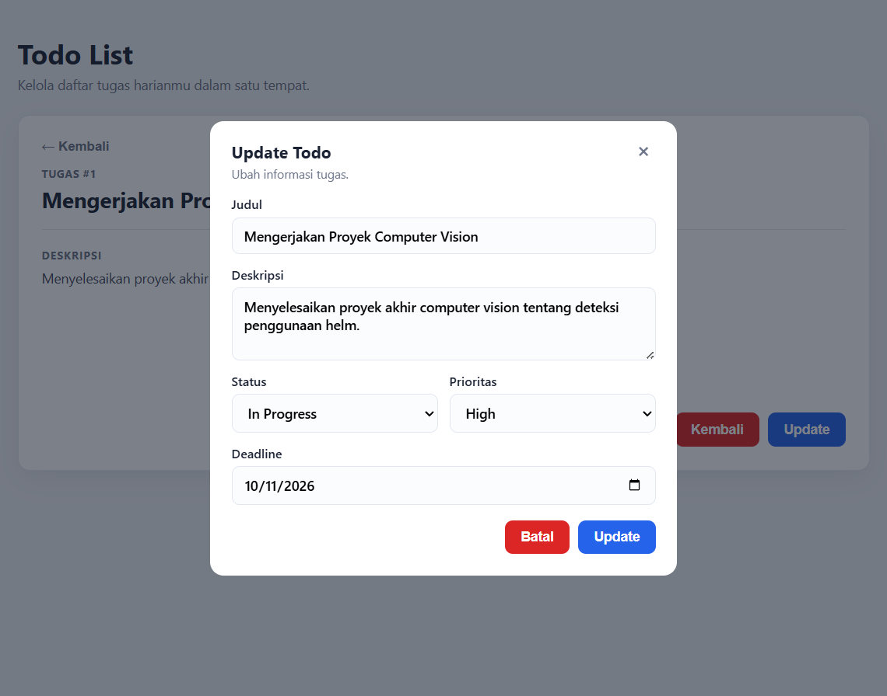
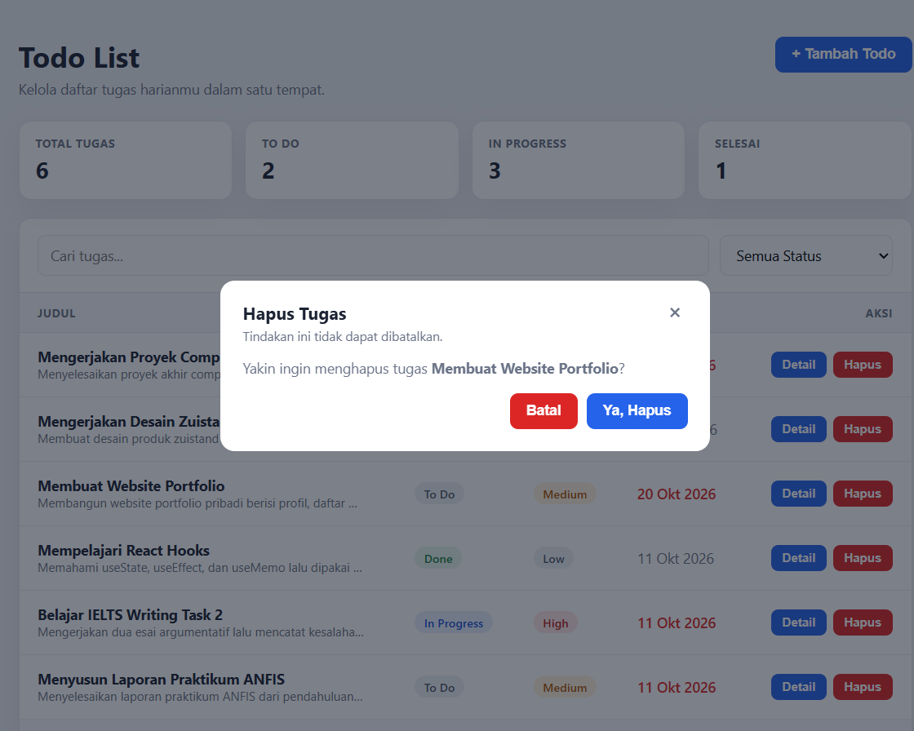

Aplikasi To-Do List

# Menjalankan
npm install
npm run dev

Buka http://localhost:5173

# Fitur

- Menampilkan daftar tugas (judul, status, prioritas, deadline)
- Melihat detail tugas
- Menambah tugas lewat formulir dengan validasi
- Memperbarui tugas
- Menghapus tugas dengan dialog konfirmasi
- Notifikasi setiap kali tugas ditambah, diubah, atau dihapus
- Pencarian dan filter status

## Screenshot

## Daftar Tugas

## Tambah Tugas

## Detail Tugas

## Update Tugas

## Konfirmasi Hapus

